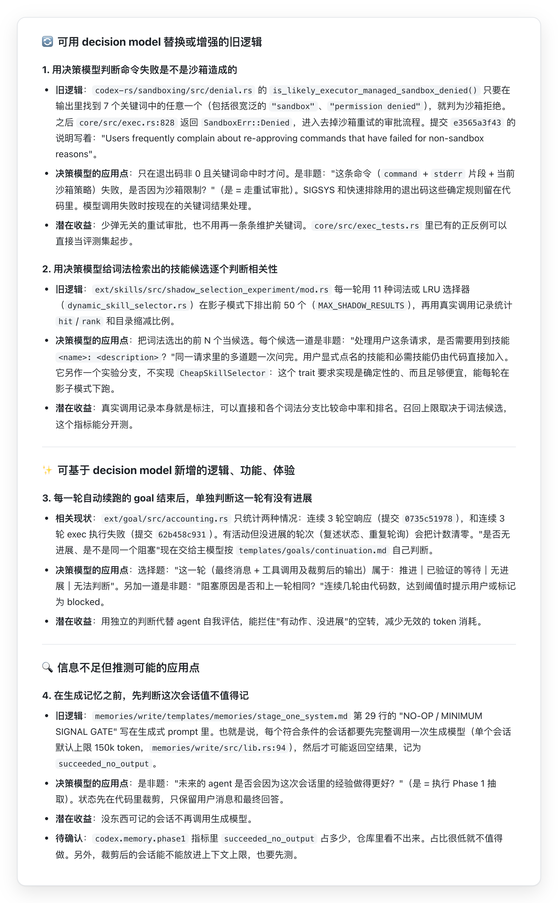

# use-decision-model

`use-decision-model` 是一个 Skill，用于分析当前项目可以如何利用 JEV 一类的决策模型（decision model）。

## 安装与调用

支持所有主流 agent/harness，包括但不限于 Claude Code、Codex、Cursor、CodeBuddy、WorkBuddy 及其他支持用户级 Skill 目录的工具。

复制以下 prompt 给你的 agent，它将引导 agent 完成分析工作，并返回分析结果：

```text
使用 https://github.com/SkyWuu/use-decision-model-skill/tree/main/skills/use-decision-model 中的 Skill 分析当前项目可以如何运用 decision model
```

## Skill 效果评测

**使用 Skill 后整体得分高出约 20%，可以发现更多、更可靠的决策模型应用机会：**

| 仓库 | 使用 Skill | 不使用 |
| --- | ---: | ---: |
| `wikipedia-ios` | 0.92 | 0.72 |
| `kickstarter-android` | 0.90 | 0.77 |
| `wechat-app-mall` | 0.93 | 0.87 |
| `netbox` | 1.00 | 0.82 |
| `shattered-pixel-dungeon` | 0.89 | 0.75 |
| `bigquery-etl` | 0.87 | 0.69 |
| `govuk-infrastructure` | 0.96 | 0.75 |
| **平均得分** | **0.92** | **0.77** |

评测基于以下真实项目仓库的分析：

- [wikimedia/wikipedia-ios](https://github.com/wikimedia/wikipedia-ios)（iOS 客户端）
- [kickstarter/android-oss](https://github.com/kickstarter/android-oss)（Android 客户端）
- [EastWorld/wechat-app-mall](https://github.com/EastWorld/wechat-app-mall)（微信小程序）
- [netbox-community/netbox](https://github.com/netbox-community/netbox)（企业内部系统）
- [00-Evan/shattered-pixel-dungeon](https://github.com/00-Evan/shattered-pixel-dungeon)（游戏客户端）
- [mozilla/bigquery-etl](https://github.com/mozilla/bigquery-etl)（数据仓库 ETL）
- [alphagov/govuk-infrastructure](https://github.com/alphagov/govuk-infrastructure)（运维与基础设施）

## Demo

使用用 Skill 分析 [Codex cli] (https://github.com/openai/codex/tree/8531184b49bcb160175a84e140b659a83a426df7)的结果：



## 目录

```text
skills/use-decision-model/
  SKILL.md                         # 硬规则 + 常见失误 + 问读者 + 六步工作流
  references/
    capability-profile.md          # 能力档案（平台团队填写）
    primitives-and-limits.md       # 三种题型、写题方法、通用局限
    signals.md                     # 三类机会的代码信号和搜索命令
    fit-and-challenge.md           # 适配条件、排除表、三关复核、设计护栏
    evidence-and-sizing.md         # git 修复热点、调用量推导、错判代价、数据敏感度
    report-template.md             # 报告模板、排版、按读者调整、示例、自查清单
evals/                             # 样例仓库、评分规则、宿主适配器和评测脚本
```
